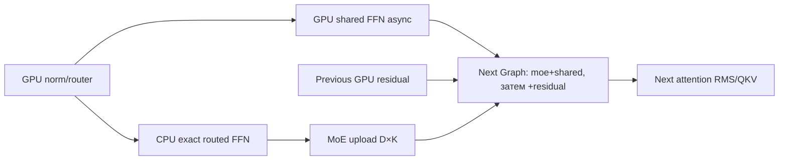

# Port7: future GPU hidden finish (только дизайн)

Runtime не менялся. Это следующий отдельный opt-in после модельного proof
COALESCE; его нельзя считать реализованным или обещать35т/с.

Ближайший уже принятый образец — `Impl::previous_hidden`: следующая dense
Graph получает CPU MoE и строит ровно `(moe + shared) + residual` на GPU,
заимствуя immutable outputs предыдущего слоя. Для verifier можно повторить
эту схему без отдельного finish-kernel/framework.

В начальном слое state hidden matrix содержит embedding; дальше тот же
буфер содержит только CPU MoE. В следующей Graph hidden expression строится
из CPU MoE alias и previousLayer shared/residual aliases. Для первых трёх
dense-only слоёв можно просто borrow previous.output, убрав их D2H/H2D.
Shared async join после CPU FFN оставить на первом correctness этапе, но
shared не копировать в RAM. Оба F32 add сохранять отдельными операциями,
порядок `(moe+shared)+residual`, fusionOFF.

В основной Graph обязательно retain OUTPUT residual; packed CPU copy его
не удерживает для внешнего consumer. Norm retain нужен sharedGraph. Shared
output принадлежит sharedGraph. Head должен стать последним consumer этой
цепочки. При reset/reconfigure освобождать head, затем layers В ОБРАТНОМ
порядке; внутри Layer shared consumer до main producer. Нынешняя независимая
layer-major схема допускает обычный vector.clear, новая cross-layer chain
требует явного reverse teardown. Все pending graph/worker потоки drain до
любого Graph destructor/буфера, включая route observer exceptions.

Feature taps4/18/32/46/60 нужны только в пяти местах. Можно materialize
GPU hidden expression и считать эти D×K rows отдельно, сохранив legacy
captured_features API/epoch. В конце один read настоящего final hidden
сохранит invariant Impl.hidden; он не должен остаться лишь CPU MoE.
Engine.logits пока обслуживает verified_logits, но скрыто менять invariant
опасно для дальнейших API/fallback. Rewind/reset правила останутся прежними.

Packed helper сейчас возвращает norm+residual+weights+ids. Первый prototype
может оставить этот формат, но тогда часть трафика не исчезнет. Полный
вариант потребует отдельного проверенного norm+weights+ids формата и одного
get, а residual/shared останутся GPU outputs. Это отдельный transport
component с payload/IDs/lifetime proof; CPU/GPU FFN arithmetic не меняется.

Измерять: shared late get/CPU sum/read_ms, число D2H и bytes, main kernels,
node counts/chunk512, total verify/HTTP TG. H2D count останется один на слой:
вместо полного hidden загрузится CPU MoE, поэтому полного исчезновения
переходов здесь нет. Добавятся два GPU add/слой. По текущему trace этот
рычаг, вероятно, меньше MSA/VIEW/coalesce/CPU critical path; точного gain
без same-ELF causal pilot нет.

Приёмка: full raw logits/features parity N1/2/3/4/5/7/8, cross256 и16/32K,
forced reject/rewind/другая ветка, exception/reset, host/GPU memory SUM,
затем clean HTTP mini. DefaultOFF до всех необходимых проверок.
